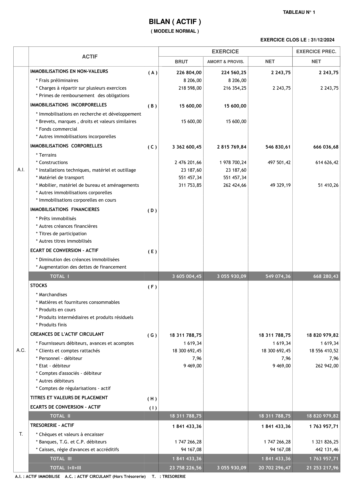
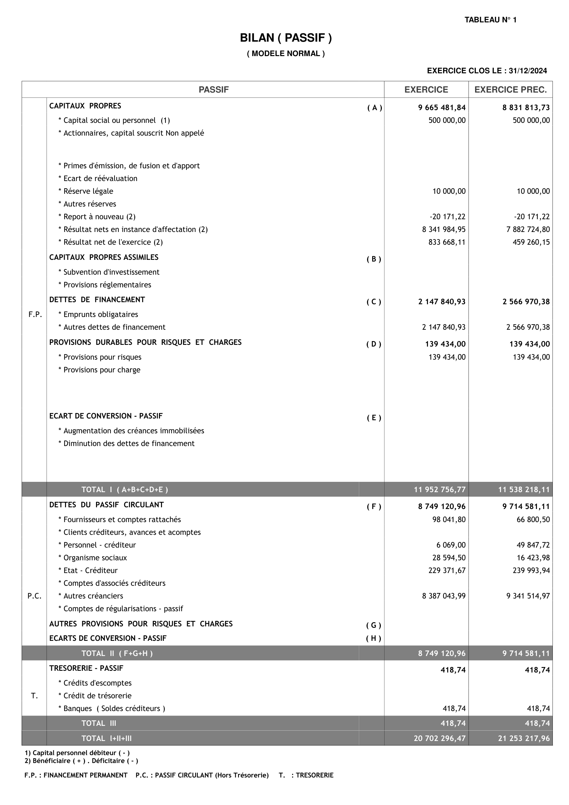
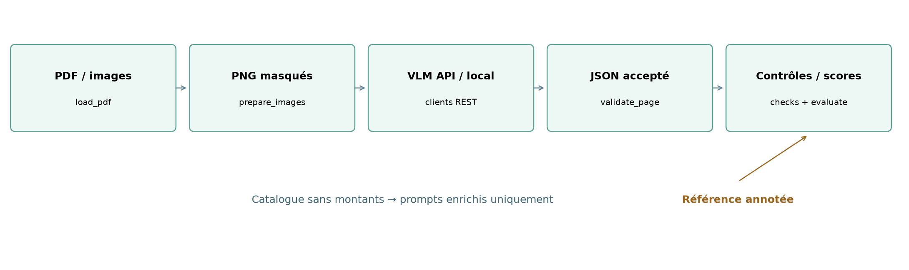
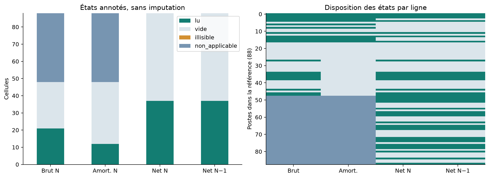
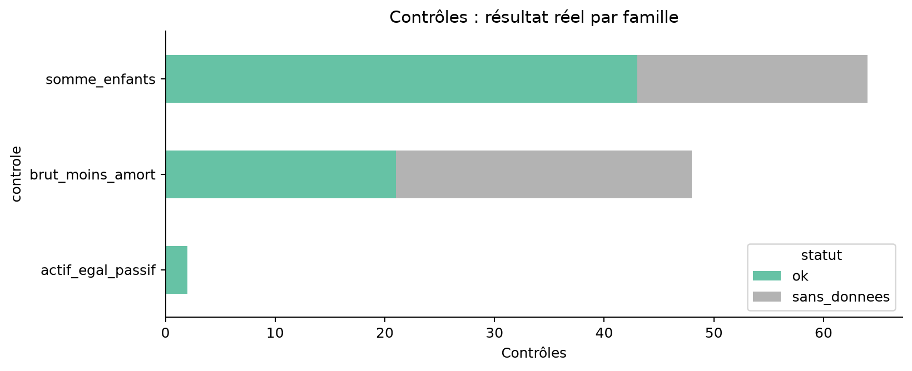
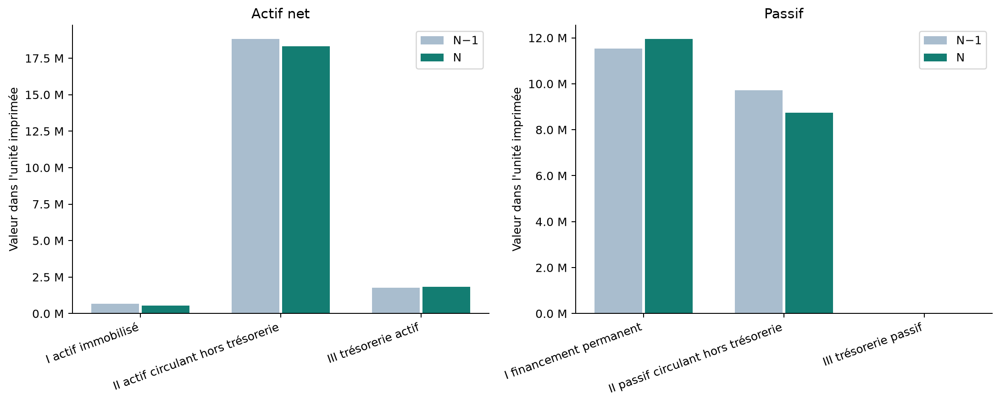
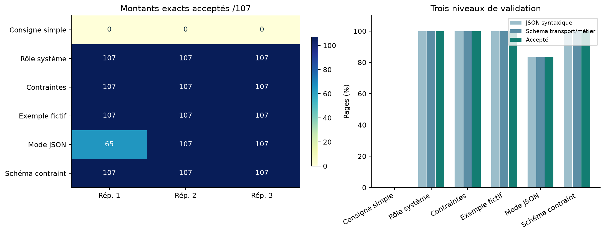
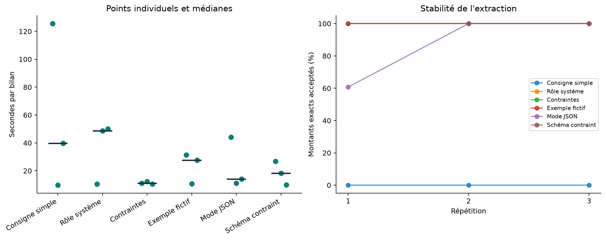
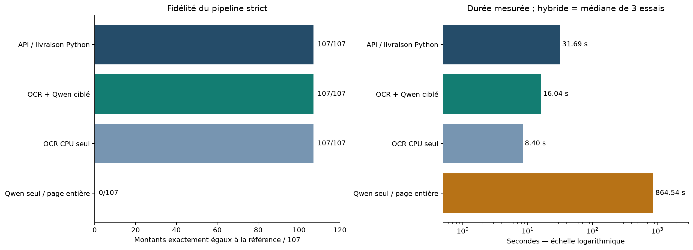
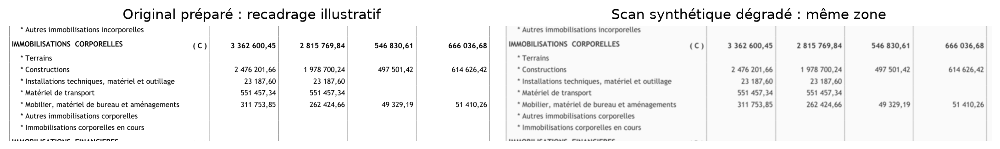

# BilanLab — plan de soutenance en 21 diapositives

**Statut : plan, figures, style, moteur image_gen et témoin approuvés.** Les 21 diapositives ont été produites. Les pages 17, 19 et 21 ont été révisées à la demande de l'utilisateur après les nouvelles mesures locales du 15 novembre 2026 ; le nombre total reste 21.

## Intention de la présentation

- Public : enseignant et étudiants du module Transformers et LLMs, ENSAM Casablanca.
- Langue : français. Format prévu : 16:9. Exactement 21 diapositives, couverture et conclusion comprises.
- Objectif : montrer la compréhension du TP, expliquer le code par ses responsabilités, défendre les choix et interpréter les résultats mesurés.
- Durée indicative : 18 à 20 minutes, à adapter au temps accordé.
- Fil conducteur : un document financier devient une donnée exploitable grâce à la lecture visuelle, au contrat JSON et à la validation indépendante.
- Privilégier une idée centrale par diapositive, des figures lisibles et des exemples concrets. Réserver les explications détaillées aux futures notes orales.
- Distinguer les exigences du TP, les améliorations réalisées et les perspectives non exécutées.

## Sources de vérité

- `../TP5_Extraction_Bilans_VLM.docx` : énoncé, parties A à D et huit questions.
- `../TP_Extraction_Bilans_VLM_Groupe9.ipynb` : code exécuté et sorties intégrées.
- `../outputs_vlm/campagne_courante.json` : nouvelle campagne identifiée, répétitions et provenance.
- `../outputs_vlm/comparaison_finale.csv` et `resultats_finaux.json` : résultats et latences par expérience.
- `../outputs_vlm/bilan_group_9_extrait.json` : extraction API de livraison après relecture séparée.
- `../outputs_vlm/bilan_group_9_TP_minimal.json` : véritable extraction directe à quatre champs, sans catalogue.
- `../outputs_vlm/diagnostic_local_brut.json` : valeurs locales avant rejet, sans correction.
- `../outputs_vlm/compte_rendu.md` et `verification_livrables.json` : interprétation et vérifications.
- Figures du notebook et captures de l'application : preuves visuelles, jamais simples références décoratives.

## Slide 1 : Extraction de bilans marocains avec un VLM

- Message : transformer un bilan PDF en JSON vérifié.
- Projet BilanLab, groupe 9, module Transformers et LLMs.
- Annoncer les trois dimensions étudiées : lecture, fiabilité et comparaison des solutions.
- Rôle : couverture sobre qui installe le sujet, sans tableau de résultats détaillé.
- Visuel prévu : composition conceptuelle originale liée au document et à la donnée structurée.
- Images sources requises : aucune.

## Slide 2 : Objectif métier et exigences du TP

- Extraire les postes et leurs montants sans ressaisie manuelle.
- Partie A : comprendre et préparer le document. Partie B : API et techniques de prompt.
- Partie C : inférence locale en bonus. Partie D : validation et évaluation.
- Livrer le code, un JSON par bilan et un compte-rendu argumenté.
- Rôle : cadrage. Expliquer le rôle de chaque partie plutôt qu'afficher une simple liste de sections.
- Images sources requises : aucune.

## Slide 3 : Le bilan étudié et ses colonnes

- Un seul bilan réel de deux pages, exercice clos le 31/12/2024.
- Actif : brut, amortissements/provisions, net N et net N−1.
- Passif : montants N et N−1. Les deux premières colonnes n'existent pas.
- L'unité imprimée n'est pas confirmée : aucune conversion arbitraire en MAD.
- Rôle : explication du document. Guider le regard sur les colonnes et les deux parties.
- Images sources requises : les deux pages anonymisées sont des entrées strictes. Préserver les chiffres et les libellés. Ne jamais utiliser le PDF original avec sa couche texte résiduelle comme illustration à transmettre au moteur d'image.
  - Actif, page préparée et masquée :

    

  - Passif, page préparée et masquée :

    

## Slide 4 : Les difficultés de lecture d'un bilan

- Qualité du scan, petits caractères, tableaux denses et alignement des colonnes.
- Différence entre une case vide, un zéro, une valeur illisible et une colonne inexistante.
- Signes négatifs, confusion entre N et N−1 et risque de changement d'échelle.
- Sous-totaux et totaux : éviter de compter plusieurs fois la même masse.
- Rôle : explication par petits exemples visuels et conséquences concrètes sur l'extraction.
- Images sources requises : aucune. Les exemples doivent être explicitement pédagogiques, sans faux résultats expérimentaux.

## Slide 5 : Architecture du pipeline et responsabilités du code

- `load_pdf` et `prepare_images` lisent et préparent le document.
- Les clients REST appellent Gemini ou Ollama, puis `validate_page` filtre les objets.
- `arithmetic_checks` vérifie les égalités et `evaluate` mesure la fidélité.
- Le catalogue transmet des libellés et identifiants sans montants. La référence annotée reste dans l'évaluation.
- Rôle : architecture commentée. Montrer où passent les données et où se placent les validations.
- Image source requise : entrée stricte. Conserver le sens des flèches, les fonctions et la séparation de la référence.

  

## Slide 6 : Prétraitement et anonymisation réelle

- PyMuPDF rend les pages en PNG à 200 DPI.
- Des masques sont appliqués aux pixels des zones d'identité.
- Les images sont sauvegardées sans couche texte résiduelle, puis inspectées.
- Seuls les PNG préparés partent vers Gemini. Le contraste renforcé est une option du code, pas un traitement activé dans l'expérience principale.
- Rôle : processus expliqué étape par étape, avec justification de chaque choix.
- Images sources requises : aucune supplémentaire. Ne pas réutiliser simplement les deux pages de la slide 3 comme décor.

## Slide 7 : Le schéma JSON minimal demandé par le TP

- Quatre champs par poste : `poste`, `rubrique`, `montant_net_N`, `montant_net_N1`.
- Le VLM génère cette version directement, sans catalogue ni valeurs de référence.
- La transcription libre produit 49 lignes actif et 41 lignes passif dans l'essai réalisé.
- Présenter un court exemple réel et expliquer pourquoi ce schéma ne distingue pas à lui seul vide et illisible.
- Rôle : explication de contrat et exemple de sortie, sans long listing de code.
- Images sources requises : aucune. Exemple à reprendre exactement dans `bilan_group_9_TP_minimal.json`.

## Slide 8 : Le schéma enrichi et les 88 postes canoniques

- Ajouter identifiants, parents, type de ligne, brut, amortissements et états de lecture.
- Distinguer `lu`, `vide`, `illisible` et `non_applicable`. Conserver les montants comme chaînes décimales.
- Regrouper les paires imprimées Trésorerie / Total III en `A_III` et `P_III` : 90 lignes visibles correspondent à 88 postes canoniques.
- La référence évalue 107 montants et 352 états/valeurs, dont 74 montants nets.
- Rôle : explication d'une amélioration justifiée et de la convention d'évaluation.
- Image source requise : entrée stricte. Préserver les effectifs, couleurs et catégories d'états.

  

## Slide 9 : Les six techniques de prompting

- Baseline, rôle système, contraintes et exemple fictif.
- Mode JSON natif, puis schéma JSON contraint pendant la génération.
- Comparaison cumulative : chaque étape enrichit la précédente. Elle n'isole pas causalement chaque composant.
- Les exemples fictifs ne contiennent pas les montants du bilan évalué.
- Rôle : comparaison pédagogique. Expliquer ce qui change dans la requête et ce que le fournisseur contraint réellement.
- Images sources requises : aucune. Contenu fondé sur `make_prompt`, `system_prompt` et `call_gemini`.

## Slide 10 : Les deux chemins d'inférence

- API : Gemini 3.1 Flash-Lite, images transmises par REST, compteurs de tokens et durée enregistrés.
- Local : Ollama et Qwen3-VL 4B Instruct, modèle quantifié Q4_K_M.
- Exécution locale sur CPU, avec `size_vram = 0` observé. Le côté maximal des images locales est 1400 pixels.
- Le modèle local choisi est dense. Expliquer le piège mémoire des modèles MoE sans prétendre en avoir exécuté un.
- Rôle : comparaison technique des configurations et des contraintes matérielles.
- Images sources requises : aucune. Preuves : journaux et `ollama_snapshot_campagne.json`.

## Slide 11 : Validation du JSON et contrôles comptables

- Rejeter Markdown, clés dupliquées, troncatures, valeurs mal formées et incohérences d'états.
- Vérifier les sommes des enfants directs, brut moins amortissements et égalité actif/passif pour N et N−1.
- Calculer les montants avec Decimal et réserver la tolérance d'un centime aux sommes.
- Une égalité comptable peut rester vraie malgré des erreurs compensées : elle ne garantit pas une transcription exacte.
- Rôle : méthode de validation et court contre-exemple technique explicitement séparé des expériences VLM.
- Image source requise : entrée stricte, résultat réel des contrôles de l'extraction principale.

  

## Slide 12 : Protocole de la nouvelle campagne

- Six variantes API, trois répétitions chacune : 18 essais de prompting.
- Même bilan, mêmes images, même modèle et température 0. Ordre mélangé avec graine 42.
- Aucun réessai de validation dans le benchmark. Les pannes et pages rejetées restent au dénominateur.
- Un seul document distinct, utilisé aussi pendant le développement. Le local CPU et la série API se sont chevauchés.
- Rôle : protocole reproductible, avec les limites qui encadrent les conclusions.
- Images sources requises : aucune. Les valeurs viennent de `campagne_courante.json`.

## Slide 13 : Résultat API de livraison

- 107/107 montants exacts, 74/74 nets et 88/88 postes canoniques.
- 66 contrôles comptables conformes, sans écart ni indétermination dans cet essai.
- Durée du document : 31,69 s pour l'extraction de livraison `principal_relecture`.
- Le premier essai principal a subi un incident de connexion. Il reste archivé et la nouvelle extraction est explicitement hors benchmark.
- Rôle : résultat principal, soutenu par un petit nombre d'indicateurs lisibles et leur provenance.
- Images sources requises : aucune. Copier les valeurs de l'expérience `principal_relecture`, jamais celles de l'ancien essai de 14,21 s.

## Slide 14 : Le bilan extrait devient lisible et exploitable

- Lire les grandes masses de l'actif et du passif pour N et N−1.
- Montrer l'égalité des totaux et la présence des colonnes dans les données produites.
- Ne pas additionner détails et sous-totaux dans une même masse.
- Les graphes illustrent l'exploitation de l'extraction, sans recommandation financière ni conversion d'unité inventée.
- Rôle : démonstration concrète de l'utilité de la sortie JSON.
- Image source requise : entrée stricte. Préserver les valeurs, unités, axes et libellés de la figure.

  

## Slide 15 : Fiabilité comparée des techniques de prompt

- Matrice des montants exacts pour les trois répétitions de chacune des six variantes.
- Baseline : 0/107 accepté dans les trois essais, notamment à cause du format rejeté. Ce score ne signifie pas qu'aucun chiffre n'a été lu.
- Rôle, contraintes, few-shot et schéma : 107/107 dans les trois répétitions de cette campagne.
- JSON mode : 65/107, puis 107/107 et 107/107. Le premier essai perd une page sur incident réseau, sans prouver un défaut de lecture du prompt.
- Rôle : preuve expérimentale et interprétation prudente des écarts.
- Image source requise : entrée stricte. Préserver intégralement la matrice et les taux de validation.

  

## Slide 16 : Vitesse, variabilité et coût estimable

- Montrer les durées individuelles et les médianes des trois répétitions.
- Une requête échouée consomme du temps. Une médiane sur trois essais ne constitue pas un classement universel.
- Les durées dépendent du réseau, du service et de la configuration. API et local utilisent des modèles et résolutions différents.
- Les coûts API sont estimés avec les compteurs connus et le tarif documenté. Un coût inconnu reste inconnu, et le coût matériel local n'a pas été mesuré.
- Rôle : analyse du compromis et explication de la méthode de mesure. Le coût détaillé peut être expliqué dans les notes sans surcharger la figure.
- Image source requise : entrée stricte. Préserver les points et médianes réels, sans lisser les échecs.

  

## Slide 17 : Une solution locale rapide : OCR et relecture ciblée

- Ancien Qwen seul : 864,54 s, 34/107 montants bruts corrects et 0/107 accepté ; échec conservé.
- Nouveau pipeline : OCR CPU, alignement géométrique, puis Qwen sur les quatre cellules OCR de plus faible confiance.
- Trois essais hybrides : chacun 107/107 montants, 352/352 états et valeurs, 66 contrôles ; médiane 16,04 s.
- OCR seul : déjà 107/107 en 8,40 s. Pas de gain causal de précision démontré de Qwen seul.
- Limites : un seul bilan, colonnes adaptées au document, Qwen déjà chargé ; comparaison des durées descriptive.
- Image source requise : entrée stricte. Conserver les deux panneaux de la comparaison et tous leurs chiffres.

  

## Slide 18 : Robustesse, relecture et traitement par lot

- Dégrader synthétiquement les images par réduction, flou et baisse de contraste.
- Sur cet essai dégradé : 107/107 montants exacts avec l'API, en 65,88 s.
- La relecture sait maintenant reprendre une page entièrement rejetée. Ses propositions restent séparées du benchmark initial.
- Deux fichiers traités dans le lot, mais une seule entreprise distincte : l'original et son scan dérivé.
- Rôle : bonus du TP, corrections réellement réalisées et limites de portée.
- Image source requise : entrée stricte. Préserver la comparaison des deux versions du même recadrage.

  

## Slide 19 : Confidentialité et choix de déploiement

- L'anonymisation doit supprimer l'information transmise et pas seulement la masquer dans une couche visuelle.
- Pour une API distante : minimisation, conditions du fournisseur, conservation et examen des formalités CNDP applicables.
- Le local garde le traitement sur la machine, mais exige aussi contrôle d'accès, gestion des secrets et règles de conservation.
- Choix pour ce PC : OCR local et relecture ciblée par Qwen, validés sur ce bilan ; API possible lorsque son usage est autorisé. Distinguer ce nouveau pipeline du VLM seul initialement en échec.
- Rôle : point de vue argumenté. Distinguer recommandation technique et validation juridique.
- Images sources requises : aucune. Les sources officielles de la loi 09-08 et de la CNDP devront figurer dans les futures notes de cette slide.

## Slide 20 : BilanLab, l'application web du projet

- Déposer un bilan, inspecter les pages et masquer les zones sensibles.
- Choisir les méthodes, suivre les durées et consulter tableau, JSON, contrôles et réponses brutes.
- Exporter les résultats et consulter les rubriques Architecture, Résultats du TP et Le projet.
- L'application est une extension du TP. Son rendu et son contrat TypeScript diffèrent du notebook Python : les chronos web et notebook ne sont pas interchangeables.
- Rôle : démonstration du produit, avec une capture réelle plutôt qu'une maquette présentée comme opérationnelle.
- Image source requise : capture réelle, entrée stricte. Composer une vue centrée sur la comparaison et le résultat. Conserver les libellés et valeurs visibles, notamment 88 postes, 107/107, 66 contrôles et le chrono web. Un cadrage de la zone utile est prévu, sans modification des chiffres.

  

## Slide 21 : Conclusion, limites et suite du projet

- L'extraction devient exploitable quand le contrat JSON, les contrôles et l'évaluation accompagnent le modèle.
- Sur le bilan fourni : API validée et nouvelle méthode locale hybride à 107/107, médiane de 16,04 s sur trois essais. L'OCR seul est déjà exact ; l'ancien échec Qwen est conservé.
- Limites principales : un seul bilan, référence utilisée en développement, absence de double annotation et coordonnées adaptées au document ; Qwen déjà chargé pendant les nouveaux essais.
- Suite proposée : corpus indépendant multi-entreprises, double annotation, matériel local adapté et mesure des coûts réels.
- Rôle : conclusion personnelle fondée sur les preuves et ouverture aux questions. Aucun résultat futur annoncé comme acquis.
- Images sources requises : aucune.

## Affectation des sources visuelles à confirmer

| Slide | Source stricte | Rôle |
|---|---|---|
| 3 | Deux PNG anonymisés `page_01.png` et `page_02.png` | Lecture du document et de ses colonnes |
| 5 | `00_architecture.png` | Pipeline et séparation de la référence |
| 8 | `04_etats_et_couverture.png` | États et convention de représentation |
| 11 | `05_controles_comptables.png` | Contrôles automatiques réellement calculés |
| 14 | `07_structure_bilan.png` | Exploitation des montants extraits |
| 15 | `01_exactitude_et_validation.png` | Résultats des 18 essais de prompt |
| 16 | `02_latence_et_stabilite.png` | Durées observées et stabilité |
| 17 | `12_optimisation_locale.png` | Comparaison mesurée : Qwen seul, OCR seul, hybride et API |
| 18 | `09_scan_original_et_degrade.png` | Dégradation synthétique du même document |
| 20 | `webapp/outputs/resultats-live.png` | Démonstration réelle de l'application, cadrage utile |

## Parti pris pour une bonne soutenance

1. Expliquer les termes avant leur utilisation : VLM, schéma, état, référence et décodage contraint.
2. Présenter le besoin, puis le choix de code qui y répond et enfin sa preuve d'exécution.
3. Garder les slides lisibles : exemples JSON courts, graphes grands et commentaires oraux plutôt qu'un copier-coller du notebook.
4. Distinguer résultat observé, interprétation et perspective. Un échec bien expliqué démontre la compréhension de la chaîne.
5. Faire ressortir les limites qui changent réellement la conclusion : aucune revendication de généralisation sur un seul bilan.

## Mise à jour locale mesurée

L'utilisateur a demandé d'améliorer le local puis de modifier la présentation. Les trois nouvelles exécutions hybrides donnent chacune 107/107 montants, 352/352 états et valeurs et 66 contrôles cohérents en 18,09 / 16,04 / 15,81 s. La nouvelle page 17 utilise le graphe comparatif complet ; les pages 19 et 21 et leurs notes sont synchronisées. L'OCR seul est exact en 8,40 s, sans gain causal de précision démontré de Qwen. Les anciennes mesures restent dans le notebook et les archives.
